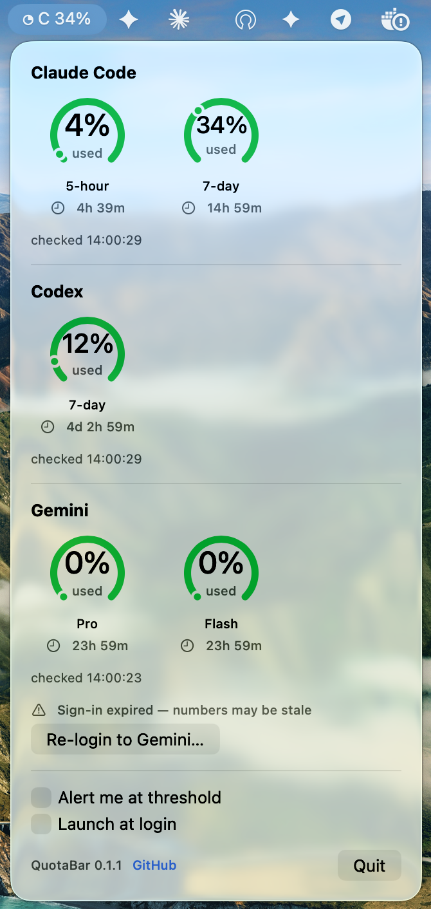

# QuotaBar

A native macOS menu bar app showing live AI-subscription usage (Claude Code,
plus Codex, Gemini and Cursor when present) as circular gauges, with a countdown to
reopening when a limit is reached. A self-contained companion to the repo's
CLI scripts (no Python needed).



> **Unofficial tool.** Not affiliated with Anthropic, OpenAI, Google, or Anysphere (Cursor); it
> reads the usage data through the same private endpoints the official CLIs
> use, and those can change without notice. See the
> [disclaimer in the root README](../README.md#disclaimer--unofficial-tool-private-endpoints).

## Requirements
- macOS 13 (Ventura) or later
- Claude Code with a Pro/Max subscription, connected once through QuotaBar's
  status line (see below) — QuotaBar never reads your Claude login.
  Codex, Gemini and Cursor sections appear automatically if those tools are
  logged in.

## Install (prebuilt)

Download `QuotaBar.dmg` from the GitHub Releases page, open it,
and drag `QuotaBar.app` to Applications. Release dmgs are Developer ID
signed **and notarized**, so Gatekeeper opens them without warnings.

The app is menu-bar-only: look for `◔ N%` in the menu bar, not the Dock.

## First run — what to expect

0. **A welcome window** explains what QuotaBar reads and how logins are used.
   Nothing is read until you click **Continue**; **Quit** exits without
   reading anything. Reopen it any time from **How it works** in the popover
   (if you miss it, the popover offers **Finish setup…**).
1. **Connect Claude Code once.** The Claude section shows **Connect Claude
   Code…** (App Store build: **Copy setup command**, then paste it in
   Terminal). That installs QuotaBar's status line into Claude Code; see
   "Claude Code status line" below. Gauges appear after your next message in
   Claude Code. No password or Keychain prompt is involved.
2. **Gauges appear** for every provider whose CLI is logged in. Codex,
   Gemini and Cursor sections show up automatically when `~/.codex/auth.json`,
   `~/.gemini/oauth_creds.json`, or the Cursor app's state database exist —
   nothing to configure.
3. **"Not signed in."** with a re-login button is the normal state for a
   provider whose CLI has no session yet. The button opens Terminal running
   that CLI (`claude`, `codex login`, `gemini`) or, for Cursor, opens the
   Cursor app; if you've never installed the CLI, the popover shows the
   `npm install -g …` command to run first.
4. **A notification permission prompt** appears right after **Continue**. Alerts are
   sent when a window hits its limit (always) and, if you turn on the
   threshold in the popover, when it crosses that threshold (off by default).
   Deny the prompt if you want no notifications at all.

QuotaBar needs at least one logged-in CLI to show anything useful. There is
no account, no sign-up, and no configuration of its own.

## Security: what the app does with your tokens

- **Claude: no credentials at all.** Usage comes from the `rate_limits` field
  Claude Code itself passes to its status line, saved by QuotaBar's bridge to
  `~/.quotabar/claude-status.json`. (Anthropic doesn't permit third-party
  apps to collect or use Claude.ai credentials, so QuotaBar doesn't.)
- For the others it **reads** each provider's credentials from the store its
  own CLI uses (Codex: `~/.codex/auth.json`, Gemini: its OAuth cache,
  Cursor: the session token in
  `~/Library/Application Support/Cursor/User/globalStorage/state.vscdb`,
  opened read-only). It never writes, refreshes, or deletes credentials.
- Each token is sent **only to its own provider's usage endpoint** — no
  telemetry, no third-party servers, no analytics.
- The full source is in `Sources/Dashboard/` — a handful of small Swift
  files you can audit, and `swift build` reproduces the app.

## Build & run (from source)

Requires a Swift toolchain (Xcode or Command Line Tools).
```bash
swift build           # compile
swift run             # run from the terminal (dev)
./build-app.sh        # produce QuotaBar.app (menu-bar-only, ad-hoc signed)
open QuotaBar.app     # launch the bundled app
```

> Note: threshold/limit notifications only fire from the built `QuotaBar.app`
> (run `./build-app.sh` then `open QuotaBar.app`). Under bare `swift run` the
> process has no bundle identifier, so notifications are silently skipped.

After running `./build-app.sh`, confirm the app works with a quick visual
smoke test (this step is performed by you, the user): run `open QuotaBar.app`
and check that a menu bar item appears showing `◔ N%` (or `…` briefly while
loading); clicking it opens the popover with circular gauges and reset
countdowns, and no Dock icon appears. Quit from the popover's Quit button.
If you are not logged in, the popover correctly shows "Not signed in." /
"Session expired." with a re-login button — that is the expected error state,
not a failure.

## Mac App Store build

A second, sandboxed flavor of the same code is built for the Mac App Store.
It differs from the DMG:

- **Claude Code and Codex only.** Gemini and Cursor need file and process
  access the App Sandbox doesn't grant.
- **Claude** comes from the same status-line file as the DMG, read through a
  read-only sandbox exception for `~/.quotabar/claude-status.json`. The
  sandbox can't edit `~/.claude/settings.json`, so setup is **Copy setup
  command** + paste in Terminal.
- **Codex** is read through a read-only sandbox exception scoped to the single file `~/.codex/auth.json`.
- **Re-login** copies the CLI command to the clipboard instead of opening
  Terminal.

The flavor is selected at compile time with `-Xswiftc -DAPPSTORE`; run the
tests for both flavors with `swift test` and `swift test -Xswiftc -DAPPSTORE`.

```bash
ADHOC=1 ./package-appstore.sh          # local sandboxed app, no Apple identities
open dist-appstore/QuotaBar.app

# Store package (needs full Xcode for the universal build):
export APP_SIGN_IDENTITY="Apple Distribution: …"
export INSTALLER_IDENTITY="3rd Party Mac Developer Installer: …"
export PROVISIONING_PROFILE=path/to/QuotaBar_Mac_App_Store.provisionprofile
export TEAM_ID=ABCDE12345
./package-appstore.sh                  # → dist-appstore/QuotaBar.pkg
UPLOAD=1 ASC_API_KEY_ID=… ASC_API_ISSUER=… ./package-appstore.sh   # validate + upload
```

One-time setup in your Apple Developer account: an **Apple Distribution**
and a **Mac Installer Distribution** certificate, a **Mac App Store**
provisioning profile for `ai.pionion.quotabar`, and an App Store Connect app
record. Listing copy, the privacy policy and App Review notes are drafted in
[`AppStore/`](AppStore/); host the privacy policy and add screenshots
(16:10, e.g. 2880×1800) before submitting.

## Re-login

When a provider's session dies, its section shows a **Re-login to …** button.
Clicking it opens Terminal running that provider's CLI — `claude`, `codex
login`, or `gemini` — or, for Cursor, opens the Cursor app (sign in there). Finish the login there, then reopen the popover: it
refreshes on open, so the gauges heal immediately.

The dashboard never refreshes or writes tokens itself. It only reads the
credential store each CLI owns, so the button is a shortcut for typing the
command — it cannot verify that the login succeeded. If the session is still
dead afterwards, the same button reappears.

Gemini is the exception that proves the rule: it mints a short-lived access
token from a long-lived refresh token on every fetch, so it rarely asks. When
it does, the refresh token itself has expired.

## What it shows
- A circular gauge per usage window (5-hour, 7-day, per-model) showing **% used**,
  colored green → amber → red as it fills. Cursor adds informational gauges
  (included pools while on-demand spend has headroom, and each model's share of
  spend) that never drive the menu bar or alerts.
- The menu bar title shows the % used of the most-constrained window (`◔ 8%`),
  or — when a limit is reached — a live `⛔ H:MM:SS` countdown to the soonest
  reopening.
- Notifications, titled with the provider (e.g. "Codex usage"), when a window
  hits its limit, plus — optionally — when it crosses your threshold (set in
  the popover; off by default).

## Claude Code status line

Claude Code runs a user-configured status line command and passes it a JSON
description of the session, which for Pro/Max subscribers includes
`rate_limits.five_hour` / `rate_limits.seven_day` (`used_percentage`,
`resets_at`). QuotaBar's bridge, `Resources/quotabar-statusline` (plain
`sh` + `plutil` + `osascript`), is that command:

- It saves **only** `rate_limits` plus a timestamp to
  `~/.quotabar/claude-status.json` — not the folder, model, transcript or cost.
- A status line you already had keeps working: it is saved on install, run
  with the same input on every update (its output is what Claude Code shows),
  and restored on uninstall. Without one, the bar shows `5h 11% · 7d 10%`.
- `quotabar-statusline --install` copies itself to `~/.quotabar/`, backs up
  `~/.claude/settings.json` to `settings.json.quotabar-backup`, and sets
  `statusLine` (honours `CLAUDE_CONFIG_DIR`). `--uninstall` restores the
  previous status line.

Limits: numbers update only while Claude Code is running (the popover says
how old they are); a window past its reset time is hidden until Claude Code
reports again; per-model weekly limits aren't in the documented data, so
they aren't shown. Claude desktop-app-only use has no documented feed.

## How it works
Claude: reads `~/.quotabar/claude-status.json` (above). Codex, Gemini and
Cursor call their own usage endpoints (Cursor: the
`DashboardService` RPCs its app uses for the usage panel). It polls every 60s; the
countdown ticks locally every second. Only reads — never writes credentials.

## Tests
```bash
swift test            # pure-logic unit tests (model, decoder, alerts, store)
```
The suite covers the model, decoders, alerts, store, coordinator, auth
recovery, and launcher. Network access sits behind a protocol and is not
unit-tested. The status-line bridge has its own suite:
`Tests/bridge/test-statusline.sh` (runs in a temporary `HOME`).
